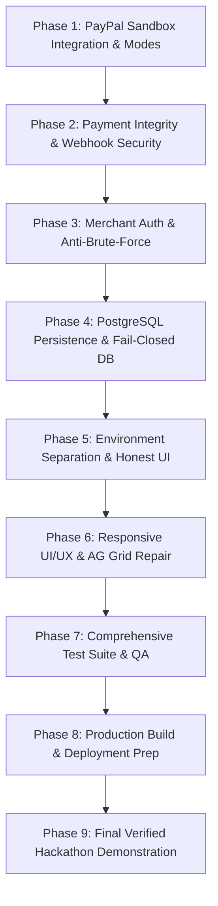

# VERNACPAY-GLOBAL — MASTER REMEDIATION PLAN

**Document Version:** 1.0.0  
**Generated Date:** November 6, 2026  
**Auditor / Architect:** Senior FinTech & AI Systems Architect  
**Principle:** Execution Reliability, Payment Integrity, Cryptographic Security, Fail-Closed Architecture, and Honest Environment Representation.

---

## 1. Remediation Phase Roadmap



---

## 2. Phase-by-Phase Technical Specifications

### Phase 1: PayPal Sandbox Integration & Mode Separation (Target for Immediate Approval)
- **Objective:** Separate MOCK simulation from genuine PayPal Sandbox API interactions. Ensure fail-closed behavior on credential or network errors.
- **Files to Modify:**
  - `src/server/services/paypalService.ts`
  - `src/server/index.ts`
  - `.env.example`
- **Detailed Changes:**
  1. Add `APP_MODE` environment variable (`MOCK` | `SANDBOX` | `PRODUCTION`).
  2. In `paypalService.ts`:
     - In `SANDBOX` or `PRODUCTION`:
       - `isMockCredentials()` must return `false`.
       - If `clientId` or `clientSecret` are missing or default, fail initialization or fail the API call closed with HTTP 502 / Error (`PayPal credentials not configured for SANDBOX mode`).
       - Remove synthetic generator fallbacks in `catch` blocks. Rethrow structured errors with HTTP status and PayPal error message.
       - Use PayPal Invoicing v2 (`/v2/invoicing/invoices`) for invoice creation, `/v2/invoicing/invoices/{id}/send`, and `/v2/invoicing/invoices/{id}/generate-qr-code`.
       - Ensure genuine returned `invoice_url` and QR code are persisted.
     - In `MOCK`:
       - Explicitly watermark mock responses (`[SIMULATED - LOCAL MOCK]`).
       - Permit local mock generators for zero-setup offline demos.
  3. Expose `GET /api/config` returning safe public environment status:
     `{ appMode: 'MOCK' | 'SANDBOX' | 'PRODUCTION', isLivePayPal: boolean }`.
- **Verification:** Unit and integration tests asserting that in `SANDBOX` mode, invalid credentials throw an error and never return synthetic mock invoices.

---

### Phase 2: Payment Integrity & Webhook Security
- **Objective:** Eliminate the random transaction fallback bug and implement database-enforced webhook deduplication.
- **Files to Modify:**
  - `src/server/agent/orchestrator.ts`
  - `src/server/index.ts`
  - `src/server/services/paypalService.ts`
- **Detailed Changes:**
  1. In `orchestrator.ts` (`processVerifiedPaymentCapture`):
     - **Remove** lines:
       ```typescript
       if (!target) {
         target = txs.find(t => t.status === 'AWAITING_BUYER');
       }
       ```
     - If no transaction matches the `orderId`, `invoiceId`, or `captureId`, return `null` and do not touch any transaction.
  2. In `src/server/index.ts` (`POST /api/paypal/webhook`):
     - If `processVerifiedPaymentCapture` returns `null`, respond with HTTP 404/422 `{ error: 'No matching transaction found for payment capture resource' }` and log an unverified audit event.
     - Verify signature via PayPal REST `/v1/notifications/verify-webhook-signature`. In `SANDBOX` and `PRODUCTION`, reject any webhook where verification fails (HTTP 401).
     - Check `webhook_and_audit_events` for `webhook_event_id`. If already present, return HTTP 200 `{ status: 'ALREADY_PROCESSED' }` without double-crediting.
- **Verification:** Automated tests dispatching mismatched IDs and duplicate event IDs.

---

### Phase 3: Merchant Authentication & Authorization
- **Objective:** Enforce authenticated merchant sessions, protect against IDOR, and eliminate 4-digit brute-force vulnerabilities.
- **Files to Modify:**
  - `src/server/index.ts`
  - `src/server/agent/orchestrator.ts`
  - `src/server/db/schema.sql`
  - `src/server/db/db.ts`
  - `src/client/store/useAppStore.ts`
- **Detailed Changes:**
  1. Add password hashing utility using Node.js built-in `crypto.scryptSync` with unique cryptographic salt.
  2. Implement merchant login endpoint `POST /api/auth/login` and session validation middleware.
  3. Issue cryptographically secure session cookies / headers (`x-merchant-token` or Bearer token).
  4. Protect all financial mutation endpoints (`/api/staged/confirm`, `/api/staged/cancel`, `/api/orders/*`) with authentication middleware.
  5. Upgrade staged confirmation codes from 4 digits (`#CNF-XXXX`) to 8-character cryptographic hex:
     `#CNF-${crypto.randomBytes(4).toString('hex').toUpperCase()}`.
  6. Verify merchant ID ownership on all mutations (`staged.merchant_id === req.merchant.id`).
- **Verification:** Security tests attempting unauthenticated requests, wrong passwords, and cross-merchant operations.

---

### Phase 4: PostgreSQL Persistence & Fail-Closed DB
- **Objective:** Eliminate silent in-memory degradation in `SANDBOX` and `PRODUCTION`. Ensure persistent storage across restarts.
- **Files to Modify:**
  - `src/server/db/db.ts`
  - `src/server/db/schema.sql`
  - `src/server/db/seed.ts`
- **Detailed Changes:**
  1. In `db.ts`: In `SANDBOX` and `PRODUCTION`, if PostgreSQL connection fails during `init()`, throw a fatal error and terminate startup.
  2. In `MOCK` mode, permit the in-memory fallback engine but log explicit warnings on boot.
  3. Ensure `schema.sql` includes unique constraints on `webhook_event_id` and foreign keys.
  4. Ensure `seedDatabase()` checks if records exist and does not overwrite modified transactions.
- **Verification:** Start server with invalid `DATABASE_URL` in `SANDBOX` mode; verify process terminates immediately.

---

### Phase 5: Environment Separation & Honest UI
- **Objective:** Ensure the user interface accurately reflects the active environment mode and disables simulated actions in production.
- **Files to Modify:**
  - `src/client/components/TopBar.tsx`
  - `src/client/components/CheckoutQrModal.tsx`
  - `src/server/index.ts`
- **Detailed Changes:**
  1. Update `TopBar.tsx` to read from `/api/config`:
     - `MOCK`: Amber badge `[LOCAL DEMO SIMULATOR]`.
     - `SANDBOX`: Blue badge `[PAYPAL LIVE SANDBOX]`.
     - `PRODUCTION`: Emerald badge `[LIVE PAYMENTS]`.
  2. In `CheckoutQrModal.tsx`:
     - Show "Simulate PayPal Payment Capture" button ONLY when `appMode === 'MOCK'`.
     - In `SANDBOX` or `PRODUCTION`, hide the simulation button and instruct the user to complete the checkout via the real PayPal Sandbox invoice URL.
- **Verification:** Inspect browser rendering under `APP_MODE=MOCK` and `APP_MODE=SANDBOX`.

---

### Phase 6: Responsive UI/UX & AG Grid Repair
- **Objective:** Fix the mobile TrustBar chip collision and desktop AG Grid header truncation.
- **Files to Modify:**
  - `src/client/components/TrustBar.tsx`
  - `src/client/components/AgGridCommandCenter.tsx`
  - `src/client/index.css`
- **Detailed Changes:**
  1. In `TrustBar.tsx`:
     - On desktop (`>= 768px`), keep the 5-stage horizontal layout.
     - On mobile (`< 768px`), render a compact, non-overlapping stepper showing current active stage pill (`Stage X of 5: [Name]`) with progress bar, preventing text bleed and collision.
  2. In `AgGridCommandCenter.tsx`:
     - Define strict `minWidth` on every ColDef:
       - `Invoice ID`: `minWidth: 140`
       - `Customer`: `minWidth: 130`
       - `Product`: `minWidth: 220, flex: 1`
       - `Amount INR`: `minWidth: 110`
       - `Amount USD`: `minWidth: 100`
       - `Status`: `minWidth: 130`
       - `Actions`: `minWidth: 120`
     - Allow horizontal scrolling if container width is constrained.
- **Verification:** Capture CDP screenshots at 390px (mobile) and 1440px (desktop) and inspect headers and chips.

---

### Phase 7: Comprehensive Test Suite & QA
- **Objective:** Add tests covering PayPal failure modes, webhook security, auth boundaries, and DB persistence.
- **Files to Modify:**
  - `tests/paypal_sandbox_integrity.test.ts`
  - `tests/auth_and_security.test.ts`
  - `tests/guardrails.test.ts`
- **Verification:** Execute `npm run test` and verify 100% passing rate.

---

### Phase 8: Production Build & Deployment Prep
- **Objective:** Ensure clean production build and deployment configuration without committed secrets.
- **Files to Modify:**
  - `render.yaml`
  - `package.json`
- **Verification:** Execute `npm run build` (client + server); verify zero build errors.

---

### Phase 9: Final Verified Hackathon Demonstration
- **Objective:** Prepare a step-by-step verified demonstration with evidence logging.
- **Artifact:** Update `REMEDIATION_EVIDENCE.md` with final findings and honest claims.

---

## 3. Strict Execution Protocol

In compliance with prompt instructions:
1. We will implement **ONE PHASE AT A TIME**.
2. We will not modify source code until the baseline and plan are presented and approved.
3. Upon approval, Phase 1 will be implemented, verified with tests, and presented before touching Phase 2.
